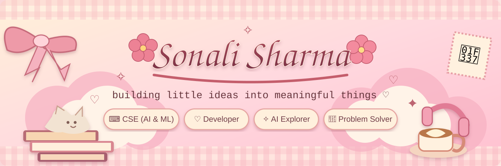

<!--
  SONALI SHARMA — GitHub Profile README
  Edit this file anytime to update your profile.
-->

computer science student · ai/ml explorer · creative developer

♡ a little scrapbook of ideas, experiments & projects ♡

  
  &nbsp;
  

---

## ୨୧ &nbsp; A little about me

> <em>collecting ideas like little treasures, then turning them into code.</em>

Hey there! I'm **Sonali Sharma** — a Computer Science student specialising in **Artificial Intelligence & Machine Learning**, currently pursuing my B.Tech at **Narula Institute of Technology, Kolkata** (2025–2029).

I enjoy turning curious ideas into useful, thoughtful software. I explore full-stack development, AI-powered applications, and projects that solve real-world problems.

- 🎓 B.Tech CSE (AI & ML), Narula Institute of Technology
- 🌱 Currently strengthening my foundations in software development, DSA and AI/ML
- 💻 Interested in Java, C, Python, frontend and backend development
- ✨ I love building, experimenting, learning and collaborating
- 🤝 Open to meaningful projects, internships and collaborations

 

## 🌷 &nbsp; My tech garden

 &nbsp;  &nbsp; 

the tools in my current creative toolbox

**Languages**

**Frameworks, tools & platforms**

**Exploring**

## 🎀 &nbsp; Things I've been building

little project postcards — click to peek inside each repository

A selection of projects from my repositories. Open each card to explore the code and its current progress.

<table>
<tr>
<td width="50%" valign="top" bgcolor="#fff0f7">

### ✿ AutoEscrow
Trust and verification infrastructure for autonomous AI-agent commerce.

<a href="https://github.com/sonalisharmas2006-oss/AutoEscrow">View repository ↗</a>

</td>
<td width="50%" valign="top" bgcolor="#f9eafa">

### ✿ Shringar — Digital Wardrobe
A gender-free digital wardrobe concept that suggests occasion-aware outfits from a personal closet.

<a href="https://github.com/sonalisharmas2006-oss/Shringar-Digital-Wardrobe">View repository ↗</a>

</td>
</tr>
<tr>
<td width="50%" valign="top" bgcolor="#fff4e9">

### ✿ H2S Dosimeter
AI-assisted passive H₂S exposure monitoring project.

<a href="https://github.com/sonalisharmas2006-oss/H2S_Dosimeter">View repository ↗</a>

</td>
<td width="50%" valign="top" bgcolor="#fce4f0">

### ✿ HireLens
An interview and hiring-focused project.

<a href="https://github.com/sonalisharmas2006-oss/HireLens">View repository ↗</a>

</td>
</tr>
<tr>
<td width="50%" valign="top" bgcolor="#f2eaff">

### ✿ Passport Tracker
A project for tracking passport-related progress.

<a href="https://github.com/sonalisharmas2006-oss/Passport_Tracker">View repository ↗</a>

</td>
<td width="50%" valign="top" bgcolor="#fff0f7">

### ✿ Student Hub
A student-focused platform and resource project.

<a href="https://github.com/sonalisharmas2006-oss/Student-Hub">View repository ↗</a>

</td>
</tr>
<tr>
<td width="50%" valign="top" bgcolor="#f9eafa">

### ✿ IBM Db2 TechX Project
My IBM Db2Hack 2026 project submission.

<a href="https://github.com/sonalisharmas2006-oss/IBM_Db2_TechX_Project_Submission">View repository ↗</a>

</td>
<td width="50%" valign="top" bgcolor="#fff4e9">

### ✿ Portfolio Hub
My personal portfolio website and its source code.

<a href="https://github.com/sonalisharmas2006-oss/Portfolio_hub">View repository ↗</a> · <a href="https://portfolio-hub-psi-beige.vercel.app/">Live site ↗</a>

</td>
</tr>
</table>

  

## ✧ &nbsp; My GitHub diary

tiny traces of the things I build and learn over time

## 💌 &nbsp; Find me around the internet

let's make something lovely together

 &nbsp;  &nbsp; 

*Always happy to connect with people who love creating things.*

  
  Made with ♡, curiosity, and a little bit of pink.

